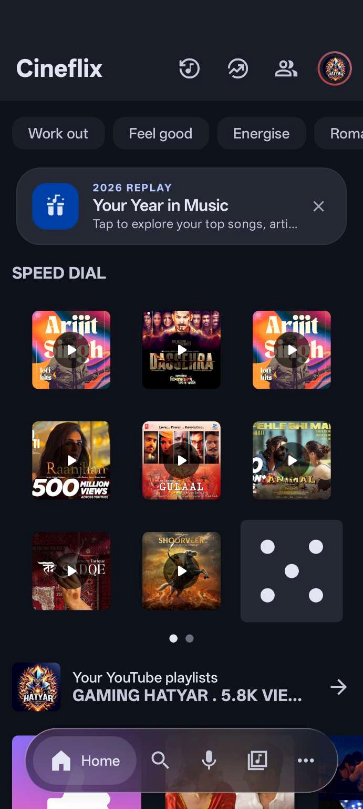
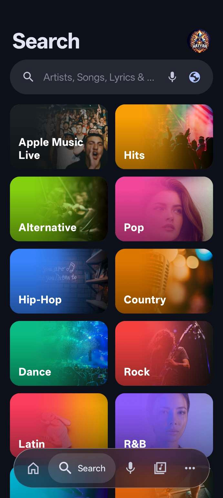
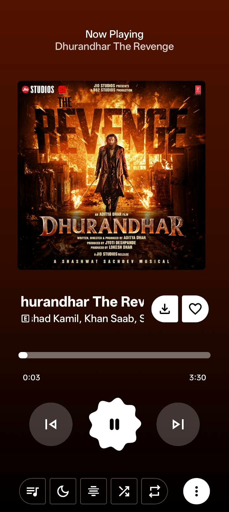
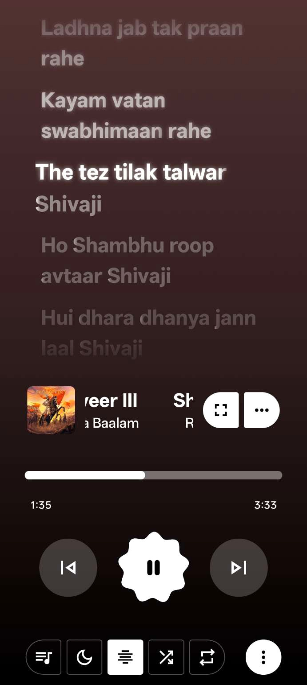
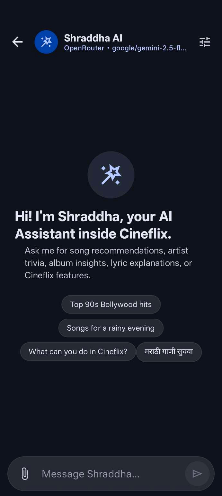
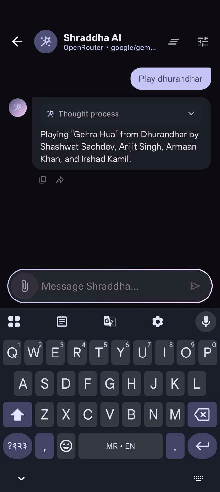
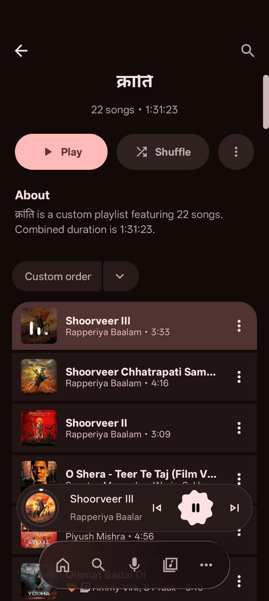
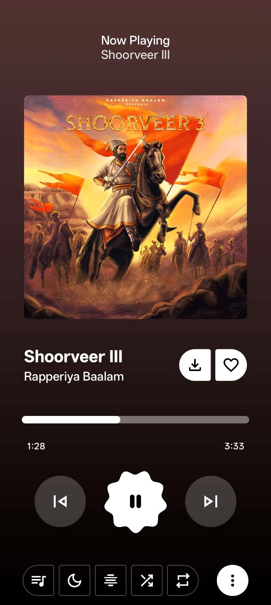

 

  

**An intelligent music experience, designed around you.**

[Features](#-the-cineflix-experience) · [Screenshots](#-screenshots) · [Shraddha AI](#-meet-shraddha-ai) · [Download](#-download-cineflix)

---

## 💜 Welcome to Cineflix

**Cineflix is more than a music player. It's your personal music ecosystem.**

Discover new tracks, enjoy immersive playback, follow synchronized lyrics, manage your offline library, and interact with your music through **Shraddha AI**.

Cineflix combines music discovery, intelligent assistance, and playback personalization in one Android experience.
## Screenshots

  <table>
    <tr>
      <td align="center"><strong>Home</strong> </td>
      <td align="center"><strong>Search</strong> </td>
      <td align="center"><strong>Now Playing</strong> </td>
    </tr>
    <tr>
      <td align="center"><strong>Lyrics</strong> </td>
      <td align="center"><strong>Shraddha ai</strong> </td>
      <td align="center"><strong>Shraddha Music Control</strong> </td>
    </tr>
     <tr>
      <td align="center"><strong>playlist marathi</strong> </td>
      <td align="center"><strong>now playing shoorveer</strong> </td>
    </tr>
  </table>

> Screenshots show selected app screens. Exact appearance and available options may vary by app version, device, and build variant.

---

## ✨ The Cineflix Experience

<table>
<tr>
<td width="50%" valign="top">

### 🎵 Discover & Explore

- Ad-free music streaming
- Search songs, albums and artists
- Explore charts, moods and genres
- Personalized music recommendations
- Spotify playlist importing

</td>
<td width="50%" valign="top">

### 🎧 Immersive Playback

- Background playback
- Audio and video switching
- Smooth crossfade transitions
- Smart playback queue
- Canvas-style music animations
- Bluetooth-aware playback behavior

</td>
</tr>
<tr>
<td width="50%" valign="top">

### 📝 Next-Level Lyrics

- Synchronized lyrics
- Word-by-word highlighting
- Multiple lyric animation styles
- Lyrics+ integration
- Lyric translation

</td>
<td width="50%" valign="top">

### 📥 Your Music, Offline

- Supported music downloads
- Dedicated download manager
- Local audio library
- Access saved music offline
- Download management

</td>
</tr>
<tr>
<td width="50%" valign="top">

### 🧠 Intelligent Music Tools

- Cineflix Find — music recognition
- Cineflix Brain — listening intelligence
- Queue suggestions
- Mood-based discovery
- Music recommendations

</td>
<td width="50%" valign="top">

### 🎨 Make It Yours

- Customizable interface
- Adjustable UI density
- Album-art presentation options
- High-refresh-rate support
- Settings search
- Video and Shorts filtering

</td>
</tr>
</table>

---

## 🧠 Meet Shraddha AI

**Your intelligent music companion inside Cineflix.**

Shraddha AI brings natural conversation and supported music controls directly into Cineflix. Ask questions, discover music, and control playback using conversational commands.

### 🎙️ Natural Music Control

| Example command | Action |
|---|---|
| Play Kesariya | Find and play a requested song |
| Pause the music | Pause playback |
| Play the next song | Skip to the next track |
| Previous song | Return to the previous track |
| Volume full | Set media volume |
| Turn on shuffle | Enable shuffle |
| Repeat this song | Configure repeat playback |
| Add this song to queue | Add a track to the queue |
| What is playing now? | Get current track information |
| Recommend calm songs | Get mood-based suggestions |

### 🌍 More Than Playback

- Natural conversational assistance
- General knowledge questions
- Web search for current information
- Music, artist and album insights
- Context-aware conversations
- English, Marathi, Hindi, Hinglish and other supported languages

### ⚡ Backend Architecture

Shraddha AI uses a separate backend service.

- Dedicated Flask backend repository
- Backend-first API routing
- Custom API fallback where configured
- Separate backend and Android application architecture

Available actions depend on supported Cineflix controls, connected services, backend availability and music sources. Shraddha does not claim unrestricted control over Android or every app screen.

---

## 🔗 Connected Ecosystem

Cineflix brings together integrations that extend your listening experience.

| Integration | Experience |
|---|---|
| Google Cast | Cast music to supported devices in the GMS build |
| Odesli / Song.link | Share cross-platform music links |
| Last.fm | Scrobble listening activity when configured |
| Discord Rich Presence | Share supported listening activity |
| Jellyfin | Connect supported self-hosted music libraries |
| Navidrome | Connect supported self-hosted music libraries |
| Set as Ringtone | Use supported tracks as your device ringtone |

---

## 🎨 Designed for Your Experience

Cineflix focuses on a clean, customizable interface with playback and discovery at its center.

- Thoughtful interface and animations
- Customizable visual presentation
- Playback-focused navigation
- Responsive layouts
- Smooth playback transitions
- Multiple build variants for different environments

---

## 📦 Download Cineflix

### Your next music experience is one download away.

  

Download the latest available APK from the official releases page. Select the appropriate build variant for your device.

---

## 🛠️ Build Variants

| Variant | Description |
|---|---|
| FOSS | Build without Google Play Services dependencies |
| GMS | Build with supported Google services and Cast functionality |
| Universal | Universal architecture package |
| ARM64 | For supported 64-bit ARM devices |
| ARMv7 | For supported 32-bit ARM devices |
| x86 | For supported x86 devices |
| x86_64 | For supported 64-bit x86 devices |

---

## 🔄 OTA Updates

Cineflix provides release updates through its dedicated updates repository.

- Browse published releases
- Download the latest available APK
- Review release notes and changelog
- Access supported update packages

**OTA Repository:** [Cineflix Updates](https://github.com/vighnya777/Cineflix-updates)

---

## 🚀 Project Links

| Resource | Link |
|---|---|
| Android Application | [Cineflix Source](https://github.com/vighnya777/Cineflix-music) |
| OTA Updates | [Cineflix Updates](https://github.com/vighnya777/Cineflix-updates) |
| Latest Download | [Latest Release](https://github.com/vighnya777/Cineflix-updates/releases/latest) |
| All Releases | [Release History](https://github.com/vighnya777/Cineflix-updates/releases) |
| Shraddha Backend | [Backend Repository](https://github.com/vighnya777/shraddha-backend) |

---

## 📌 Latest Release Information

| Release Field | Value |
|:---:|:---:|
| **Version** | `1.4.9` |
| **Version Code** | `170` |
| **Release Tag** | `v1.4.9` |
| **Platform** | Android |
| **Updates** | OTA Releases |

---

## 💜 The Vision

Cineflix brings music, technology and intelligent interaction into one connected experience.

**Discover something new. Feel every beat. Let Shraddha make it smarter.**

**Your Music. Your Vibe. Your AI.**

